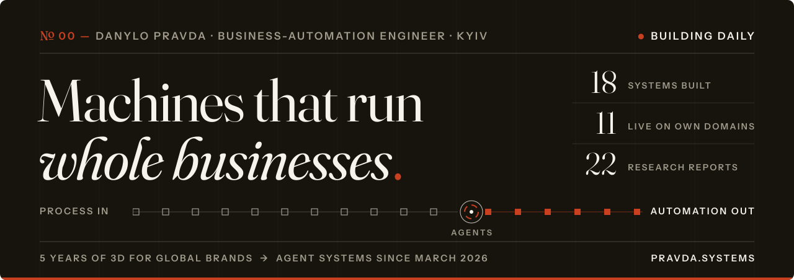

  
  
  
  

I spent five years as a senior 3D designer for brands like L'Oréal, Crocs, Lacoste and Breitling — always with a layer of scripts under the pictures. One pipeline rendered **6,000 CGI videos** through hundreds of Python scripts gluing Cinema 4D, Houdini, After Effects, Blender and ffmpeg.

In March 2026 I asked Claude to help with one more script and never stopped. Now I'm one engineer running a fleet of AI agents, and I build **machines that take a repetitive business process in and hand back a working automation** — with the receipts to prove it runs.

Most of my repositories are private: client work, trading and products that aren't out yet. Everything below is public, and every live system runs on its own domain.

### № 01 — Receipts

<table>
  <tr>
    <td align="center" width="20%"><h2>89</h2>repositories since March 2026</td>
    <td align="center" width="20%"><h2>30.4K</h2>contributions since March 2026</td>
    <td align="center" width="20%"><h2>312B</h2>Claude Code tokens #1 all-time on <a href="https://ccgather.com/u/dprvda">ccgather</a></td>
    <td align="center" width="20%"><h2>18 · 11</h2>systems built · live on own domains</td>
    <td align="center" width="20%"><h2>22</h2>sourced research reports, free to read</td>
  </tr>
</table>
Figures as of 13 Oct 2026.

### № 02 — Systems running right now

Bespoke automations, each built for a real job. Open any one and watch it work.

| System | What goes in → what comes out |
|---|---|
| **[Relight](https://relight.pravda.systems)** | Raw building photos in. Marketing-ready images out — every untouched pixel stays exactly as shot. |
| **[Fabryka](https://fabryka.pravda.systems)** | Product photos and merchant facts in. Marketplace listings ready to post out. |
| **[Scribeline](https://scribeline.pravda.systems)** | Photos of the job in. A quote the owner approved out. |
| **[Nightdesk](https://nightdesk.pravda.systems)** | The client report that writes itself overnight — every figure proved before it sends. |
| **[Observatory](https://observatory.pravda.systems)** | Buyers now ask an AI who to hire. This shows whether it says your name. |
| **[Assay](https://assay.pravda.systems)** | Messy supplier documents in. Clean, checked rows in your books out. |
| **[Pressrun](https://pressrun.pravda.systems)** | A video for every product in the catalogue. Checked, approved, delivered. |
| **[Imprimatur](https://imprimatur.pravda.systems)** | Creative work reviewed and approved, without the email chaos. |
| **[Market Radar](https://market-radar.pravda.systems)** | Every move your rivals make, on the record. |
| **[Leadline](https://leadline.pravda.systems)** | Answers every lead specifically, books it and alerts the owner. *In build.* |
| **[Proofdesk](https://proofdesk.pravda.systems)** | The knowledge desk that refuses to guess — no source, no answer. *In build.* |

Nine live, two in build. Full catalogue at <a href="https://pravda.systems/work">pravda.systems/work</a>

**Trading.** A production trading system for Bitcoin's 5-minute prediction markets, built and run by one engineer: 21 µs decisions measured over 506,243 calls, 11 live venues, 2,948 automated tests and 13 commit gates with no bypass flag. Runs in paper mode. [Case study →](https://pravda.systems/work#btc-bot)

**Agent infrastructure — the tools that make one engineer enough.** [Commonplace](https://pravda.systems/work#commonplace), a cited memory of everything my agents have ever done · [Signet](https://pravda.systems/work#signet), agents ask once from my phone and the answer becomes a standing rule · [ADE](https://pravda.systems/work#ade), one cockpit over a fleet of coding agents · [Shakedown](https://pravda.systems/work#shakedown), acceptance QA that proves its verdict with screenshots · [Slipway](https://pravda.systems/work#slipway), a repo's agent discipline composed from versioned blocks.

### № 03 — On the bench

- **[Beamline](https://beamline.io)** — a React UI system with 200+ components and 50+ screens, made to be installed and edited by coding agents. The free MIT sample is [public](https://github.com/dprvda/beamline).
- **Trading infrastructure in Rust**, second generation. Private.
- **AI research and automation for enterprise clients.** Private.

### № 04 — How I work

- **One engineer, many agents.** Parallel coding-agent sessions — Claude Code, Codex and others — in isolated git worktrees. Tokens are cheap; calendar time is not.
- **Evidence or it didn't happen.** Every live system ships with a proof page, measured numbers and dated captures — including what doesn't work yet.
- **Fail closed.** An AI never approves its own work. If a claim can't be checked against the source, nothing ships.
- **Rules live in the repo, not in good intentions.** Commit gates, hooks, skills and project memory hold agents to the same standard every session.

### № 05 — Open source

  
  
  
  

### № 06 — Tools

  
   
  From the 3D years:
   
  

### № 07 — Activity

  
  

  

<picture>
  <source media="(prefers-color-scheme: dark)" srcset="https://raw.githubusercontent.com/dprvda/dprvda/output/snake-dark.svg">
  <source media="(prefers-color-scheme: light)" srcset="https://raw.githubusercontent.com/dprvda/dprvda/output/snake-light.svg">
  
</picture>

---

  <b>Give me one repetitive process. I hand it back automated.</b> 
  <a href="https://pravda.systems/#contact">pravda.systems</a> · <a href="mailto:danylo@pravda.systems">danylo@pravda.systems</a>

