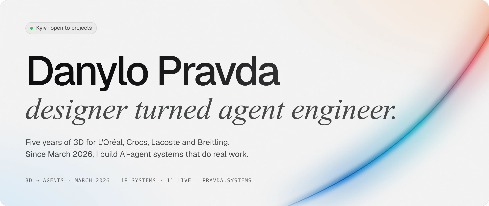
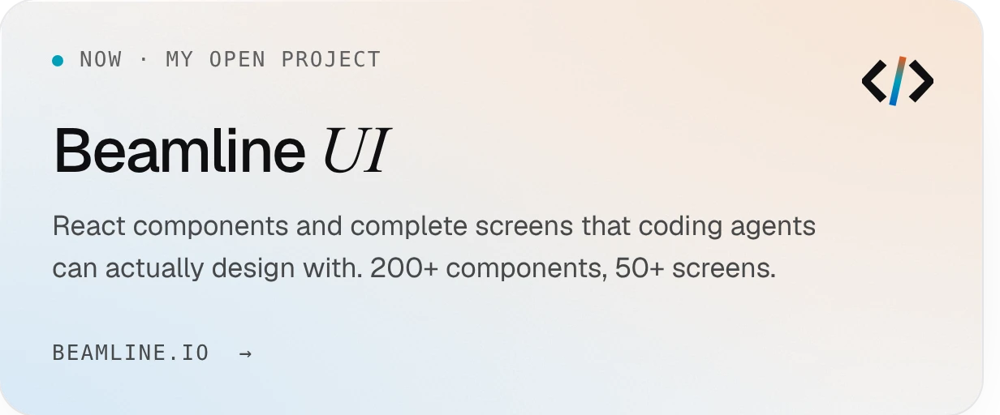
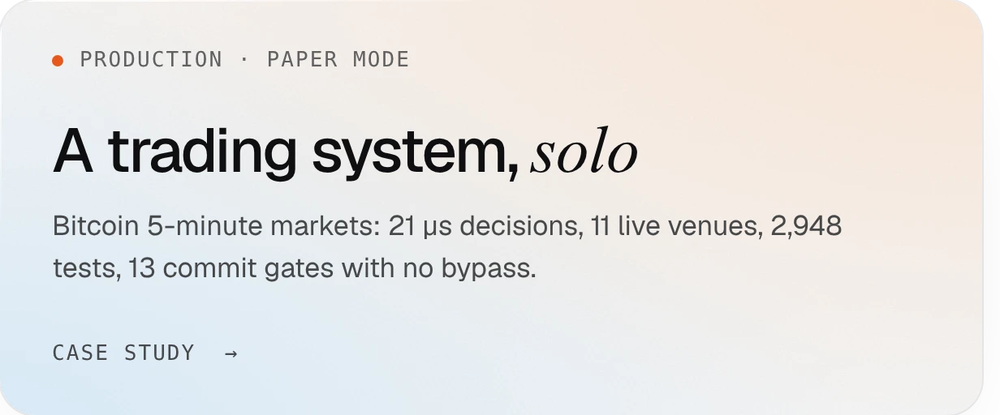
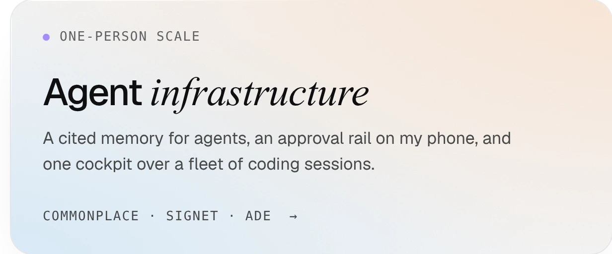
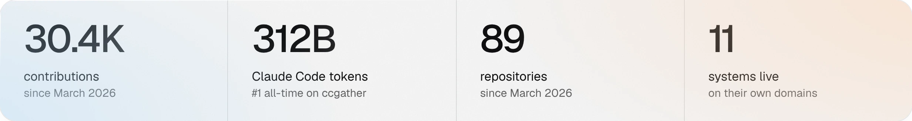

<a href="https://pravda.systems"><picture><source media="(prefers-color-scheme: dark)" srcset="assets/hero-dark.webp"></picture></a>

[pravda.systems](https://pravda.systems) · [beamline.io](https://beamline.io) · [X @danylo_pravda](https://x.com/danylo_pravda) · [danylo@pravda.systems](mailto:danylo@pravda.systems)

### Selected work

<a href="https://beamline.io"><picture><source media="(prefers-color-scheme: dark)" srcset="assets/card-beamline-dark.webp"></picture></a><a href="https://pravda.systems/work"><picture><source media="(prefers-color-scheme: dark)" srcset="assets/card-automations-dark.webp"></picture></a>

<a href="https://pravda.systems/work#btc-bot"><picture><source media="(prefers-color-scheme: dark)" srcset="assets/card-trading-dark.webp"></picture></a><a href="https://pravda.systems/work#tooling"><picture><source media="(prefers-color-scheme: dark)" srcset="assets/card-agents-dark.webp"></picture></a>

### By the numbers

<picture><source media="(prefers-color-scheme: dark)" srcset="assets/numbers-dark.webp"></picture>

As of 13 Oct 2026 · token figure from <a href="https://ccgather.com/u/dprvda">ccgather</a>
